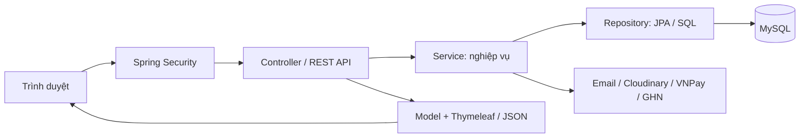
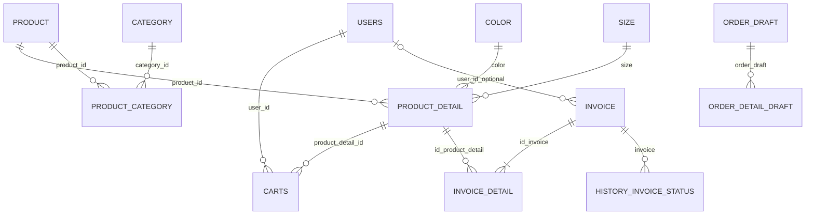

# 02 — Kiến trúc, model và dữ liệu

[Mục lục](README.md) · [Chức năng](03-CHUC-NANG-VA-PHAN-QUYEN.md) · [Luồng nghiệp vụ](04-LUONG-NGHIEP-VU.md)

## 1. Công nghệ và kiến trúc

Java 17, Spring Boot 3.4.3, Spring MVC, Spring Security, Spring Data JPA/Hibernate, MySQL; giao diện Thymeleaf, Bootstrap, JavaScript/jQuery/Select2. Đây là ứng dụng server-rendered có thêm JSON API, không phải frontend React/Vue tách biệt.

| Thành phần | Vị trí | Trách nhiệm |
|---|---|---|
| Main | `src/main/java/com/web/ShopgiaythethaoApplication.java` | Khởi động Spring Boot |
| Controller | `controller/user`, `controller/admin`, `controller/employee` | Nhận request, đưa dữ liệu vào Model, trả trang/redirect |
| REST API | `api` | Nhận/trả JSON, phục vụ AJAX và một số tích hợp |
| Service | `service`, một số lớp trong `utils` | Xử lý giỏ, hóa đơn, tài khoản, thống kê, dịch vụ ngoài |
| Entity/model lưu trữ | `entity` | Ánh xạ bảng bằng JPA |
| Repository | `repository` | Truy vấn, ghi dữ liệu, native SQL và khóa dòng cần thiết |
| DTO / Mapper / Specification | `dto`, `mapper`, `specification` | Dữ liệu request/response, chuyển đổi và lọc truy vấn |
| Security/config | `config`, `doss` | Cấu hình bảo mật, đăng nhập, khóa tài khoản, WebSocket… |
| Template | `src/main/webapp/views` | HTML dùng Thymeleaf |
| Tài nguyên | `src/main/webapp/css`, `js`, `lib`, `data` | CSS, JS, thư viện và dữ liệu tra cứu |
| Properties | `src/main/resources` | Cấu hình chung và profile |

Maven copy `views` vào `target/classes/templates`, tài nguyên web vào `target/classes/static`. Vì thế không sửa trực tiếp file trong `target`; sửa source rồi build lại. `CheckoutService` hiện là lớp khung; luồng checkout thực tế chủ yếu nằm trong `InvoiceService` và `ShippingPolicy`.

## 2. Phân biệt các nghĩa của “model”

- **Entity/domain model**: `User`, `Product`, `Invoice`… mô tả dữ liệu lưu database.
- **DTO**: dữ liệu trao đổi như `CartResponse`, `Result`, không nhất thiết tương ứng một bảng.
- **Spring MVC Model**: dữ liệu controller truyền cho template, ví dụ danh sách sản phẩm/giỏ hàng. Không phải bảng database.

## 3. Danh sách entity theo phân hệ

Các tên dưới đây là tên lớp Java. Tên bảng/cột thực tế xem annotation và SQL; không suy đoán chỉ bằng tên lớp.

| Nhóm | Entity | Nội dung chính |
|---|---|---|
| Tài khoản | `User` | Email, BCrypt password, họ tên, điện thoại, địa chỉ, vai trò, kích hoạt, xóa/khóa, số lần sai và thời điểm khóa |
| Xác thực | `OtpCode` | Dữ liệu mã xác thực, liên hệ/tài khoản và thời gian |
| Đăng ký chờ | `PendingRegistration` | Email, hash mật khẩu, thông tin đăng ký và thời hạn; chưa phải tài khoản. Chỉ tạo `User` sau OTP, hoặc xóa yêu cầu chờ khi Google xác minh cùng email |
| Sản phẩm | `Product` | Tên, slug, ảnh, giá chung, mô tả, trọng lượng, SEO, active, số đã bán |
| Biến thể | `ProductDetail` | Product ID, màu, size, SKU, giá riêng, giá cũ, tồn kho, active |
| Thuộc tính | `Color`, `Size` | Danh mục màu và kích cỡ |
| Danh mục | `Category` | Danh mục có quan hệ cha–con, slug, thứ tự, ảnh |
| Liên kết danh mục | `ProductCategory` | Liên kết sản phẩm–danh mục |
| Danh mục phụ trợ | `ParentCategory` | Entity có trong source; cấu trúc cha–con chính của `Category` dùng tự tham chiếu, không xem lớp này là toàn bộ cây danh mục |
| Ảnh | `ProductImage`, `ProductColorImage` | Ảnh sản phẩm và ảnh theo màu |
| Giỏ hàng | `Cart` | Bảng `carts`, user ID, product detail, số lượng; unique theo user + biến thể |
| Hóa đơn | `Invoice` | Mã đơn, người nhận, địa chỉ, tiền hàng, ship, giảm giá, loại đơn, thanh toán, trạng thái, token và thời gian |
| Dòng hóa đơn | `InvoiceDetail` | Invoice ID, biến thể ID, bản chụp tên/ảnh/màu/size/SKU/giá và số lượng tại thời điểm mua |
| Lịch sử đơn | `HistoryInvoiceStatus` | Invoice, trạng thái, thời gian và thông tin người thao tác |
| Lịch sử thanh toán | `HistoryPay` | Order ID, request ID, số tiền, ngày/giờ; có model không bảo đảm mọi callback đã ghi log đầy đủ |
| Hóa đơn chờ tại quầy | `OrderDraft`, `OrderDetailDraft` | Người tạo, khách hàng, chi tiết biến thể, số lượng, giá, tổng tiền, giảm giá; chuyển thành hóa đơn chính thức |
| Mã giảm giá | `Voucher` | Mã, tên, số tiền giảm, điều kiện tổng tiền tối thiểu, cờ khóa |
| Giảm giá sản phẩm | `DiscountProduct` | Sản phẩm, kiểu/mức giảm, giới hạn giảm, thời gian bắt đầu/kết thúc và người liên quan |
| Nội dung | `Blog`, `Banner`, `Contact` | Bài viết, quảng cáo/banner và liên hệ |
| Tương tác | `Chatting`, `ProductViewHistory` | Tin nhắn và lịch sử xem phục vụ gợi ý |
| Cấu hình dịch vụ | `CloudKey`, `KeyTelegram`, `ShopeeKey` | Cấu hình nhà cung cấp; có thể chứa thông tin nhạy cảm, không công khai bản ghi thật |
| Địa chỉ | `Province`, `Wards` | Tỉnh/phường theo code; không phải nguồn danh mục local đang được checkout tải từ JSON |

Mở trực tiếp [thư mục entity](../src/main/java/com/web/entity) để xem toàn bộ field/annotation. Không phải mọi entity đều có đầy đủ màn CRUD hoặc một luồng đã được sử dụng/kiểm thử.

## 4. Quan hệ dữ liệu trọng tâm

Sơ đồ là **quan hệ logic**, gồm cả cột ID được service quản lý; không khẳng định mọi đường nối đều có foreign key vật lý/JPA association.

Đơn khách vãng lai có thể không có `userId`. `ProductDetail.productId`, `InvoiceDetail.idInvoice`, `InvoiceDetail.idProductDetail` là các ID scalar, khác với những field có `@ManyToOne`. Một bản ghi lỗi/chưa hoàn chỉnh vẫn có thể không tuân theo số lượng dòng trên sơ đồ nghiệp vụ.

## 5. Các field và quy tắc cần hiểu

| Model | Điểm quan trọng |
|---|---|
| `ProductDetail` | Tồn kho ở từng tổ hợp màu/size, không chỉ ở sản phẩm cha. Có cả `colorId`/`sizeId` và quan hệ `color`/`size`; khi sửa SQL phải kiểm tra cột mà truy vấn đang dùng |
| `Product` | `stock` và `categoryIds` có phần transient; không phải mọi field trên Java đều là cột được lưu |
| `Invoice` | `totalAmount` là tiền hàng; tổng khách trả của checkout là tiền hàng + ship − giảm giá. Không mặc định mọi truy vấn doanh thu dùng cùng công thức |
| `InvoiceDetail` | Lưu bản chụp thông tin; đổi tên/giá sản phẩm sau này không nên tự sửa nội dung đơn cũ |
| `User` | `role` dùng enum `ROLE_ADMIN`, `ROLE_EMPLOYEE`, `ROLE_USER`; không nhập mật khẩu thuần vào cột BCrypt |
| `Category` | Quan hệ cha–con tự tham chiếu; xóa cần xem cascade và sản phẩm đang liên kết |
| `Invoice`/history | `createdDate`, `completedDate`, ngày lịch sử trạng thái có ý nghĩa khác nhau đối với báo cáo |

Mã đang dùng `Double` cho nhiều khoản tiền; không mô tả là hệ thống kế toán chính xác theo số thập phân. Những thay đổi sản xuất nên đánh giá `BigDecimal`, làm tròn, hoàn tiền và đối soát.

## 6. Hai nhóm bảng trong SQL

[f6s_shop.sql](../f6s_shop.sql) giữ cả bảng Java tiếng Anh và bảng nguồn tiếng Việt. Ứng dụng dùng `users`, `product`, `product_detail`, `invoice`, `blog`… Không có cơ chế đồng bộ hai chiều với `tai_khoan`, `san_pham`, `bai_viet`.

Xem [danh sách bổ sung](../DANH_SACH_BO_SUNG.md) trước khi nhập/chỉnh dữ liệu. Không suy ra mật khẩu gốc từ hash, không import toàn bộ SQL lên dữ liệu thật để chỉ đổi giao diện. Cấu hình `ddl-auto=update` không thay thế một hệ thống migration/versioning và sao lưu.
