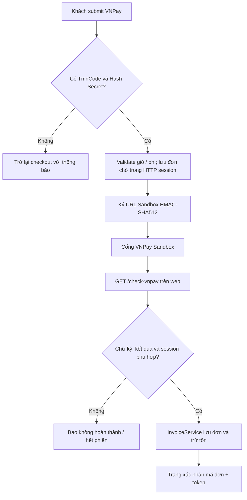

# 04 — Luồng chạy và xử lý nghiệp vụ

[Mục lục](README.md) · [Model](02-KIEN-TRUC-VA-MODEL.md) · [Chức năng](03-CHUC-NANG-VA-PHAN-QUYEN.md)

Các luồng dưới đây mô tả code hiện tại, không phải cam kết mọi nhánh đã chạy đúng. Chỉ tên controller/service thực tế được dùng làm điểm tra cứu.

## 1. Khi khởi động ứng dụng

Java main → Spring Boot nạp cấu hình chung + profile `dev` mặc định → tạo bean/security/JPA → kết nối database và cập nhật schema theo cấu hình → chạy initializer (có thể tạo/reset admin nếu đặt biến) → phục vụ request trên cổng cấu hình. Bot Telegram thủ công được bỏ qua khi thiếu cấu hình, không phải bắt buộc để chạy trang bán hàng.

Nếu không thấy `Started...`, đọc lỗi gốc gần `Caused by` trước; chưa chuyển sang chẩn đoán lỗi trình duyệt. Nếu đã Started nhưng trang lỗi, tiếp tục xem log request/controller/template.

## 2. Xem sản phẩm và giỏ hàng

1. Khách mở `/` hoặc `/category/{slug}`; controller lấy dữ liệu qua service/repository và render template.
2. Mở `/product/{slug}`, chọn màu/size tương ứng `ProductDetail`.
3. POST `/api/v1/cart/add` với ID biến thể và số lượng.
4. `CartService` phân nhánh: chưa đăng nhập lưu session `cartSession`; đăng nhập lưu bảng `carts` theo user ID.
5. Đổi số lượng/xóa qua API giỏ; khi checkout chỉ lấy các biến thể được chọn bằng tham số `detail`.

Giỏ không phải hóa đơn và không bảo đảm giữ trước tồn kho. Trước khi chốt phải kiểm tra tồn lại. Không coi một dòng sản phẩm cha là đủ xác định size/màu.

## 3. Mua online bằng COD

```mermaid
sequenceDiagram
    actor K as Khách
    participant C as CheckoutController
    participant I as InvoiceService
    participant S as ShippingPolicy
    participant D as MySQL
    K->>C: GET /checkout?detail=...
    C-->>K: Giỏ được chọn + form nhận hàng
    K->>C: POST /checkout (COD)
    C->>I: createInvoice(...)
    I->>I: Lấy giỏ, validate thông tin/voucher
    I->>S: Tính lại phí từ phía server
    S-->>I: Phí local hoặc báo giá GHN
    I->>D: Tạo invoice; khóa và kiểm tra biến thể
    alt Không đủ tồn
        I->>D: Đánh dấu rollback
        I-->>K: Thông báo lỗi
    else Hợp lệ
        I->>D: Trừ tồn, lưu dòng đơn, mã/token, lịch sử
        I-->>C: Kết quả thành công
        C-->>K: /success-order/{code}?token=...
    end
```

Điểm chính: `InvoiceService.createInvoice` đặt loại `ONLINE`, thanh toán `COD`, trạng thái `DANG_CHO_VAN_CHUYEN`; transaction và khóa dòng ở nhánh này giúp kiểm tra tồn khi chốt. Có gọi gửi email/thông báo Telegram/WebSocket; khả năng gửi thực tế phụ thuộc cấu hình dịch vụ.

Tiền khách trả ở checkout = tiền hàng + phí vận chuyển − voucher. Backend tính lại ship; không tin `phiShip` sửa bằng DevTools. Với `local`, phí mặc định 30.000đ, miễn từ 500.000đ; quy tắc miễn phí xét tiền hàng theo code hiện tại.

## 4. Địa chỉ và phí giao hàng

| Chế độ | Luồng |
|---|---|
| `local` | Tải JSON cùng website → tìm tỉnh/thành phố → lọc phường/xã → chọn phường và tự điền quận/huyện → gửi **tên** địa chỉ. Đổi tỉnh xóa dữ liệu cấp dưới. Phường trùng tên có nhãn quận để phân biệt |
| Địa chỉ mới | Gõ tỉnh/phường rồi chọn “Dùng địa chỉ”; không ép thuộc danh mục cũ, quận/huyện có thể trống. Danh mục 3 cấp được ghi rõ là trước 07/2025 |
| `ghn` | Chọn tỉnh → API huyện → API phường → API phí theo mã huyện/phường, trọng lượng; server tính lại phí. Cần cấu hình kho/shop/token đúng |

Đổi thứ tự chọn local không đổi mã GHN. Chế độ GHN giữ phụ thuộc tỉnh → huyện → phường của nhà cung cấp. Không âm thầm chuyển local khi GHN lỗi; form GHN chặn xác nhận khi thiếu địa chỉ/phí hợp lệ. Local không tự tạo vận đơn GHN.

## 5. VNPay Sandbox



Mã: `CheckoutController.checkoutPostVnpay` → `InvoiceService.createInvoiceSession` → `VNPayService.createOrder`; khi trở về: `InvoiceService.checkVnpay` → `VNPayService.orderReturn`.

Số tiền gửi cổng bằng VND × 100; thời gian tạo dùng `Asia/Ho_Chi_Minh`, hết hạn sau 15 phút. Return URL lấy từ request và kết thúc `/check-vnpay`; mở web bằng HTTPS ngrok ngay từ đầu để giữ đúng origin/session. Đổi trình duyệt/host, xóa cookie hoặc restart server có thể mất đơn chờ.

Giới hạn quan trọng: đây là return theo session, không phải luồng IPN production đã hoàn thiện. Nhánh trừ tồn VNPay không có cùng khóa dòng/rollback kiểm chứng như COD; kiểm tra chống lặp, đối chiếu số tiền/merchant, lưu lịch sử và lỗi tồn sau thanh toán cần được rà soát thêm. Không mô tả “khách trả tiền chắc chắn đơn đã được ghi nhận” khi chưa kiểm thử các trường hợp này. Xem [hướng dẫn Sandbox](../VNPAY_SANDBOX.md).

## 6. Bán hàng tại quầy

1. Admin/nhân viên đăng nhập → `/invoice/create` trong khu vực tương ứng.
2. Tạo/cập nhật `OrderDraft` qua API `/api/order-draft/create`.
3. Thêm biến thể qua `/add-to-order`; tạo `OrderDetailDraft`, chỉnh số lượng/xóa dòng; tính lại tổng.
4. Điền thông tin khách, kiểm tra giá/giảm giá và loại đơn.
5. `/save-order-to-invoice` gửi `orderId`, `invoiceType`, `invoiceStatus` → `OrderDraftService.changeToInvoice`.
6. Map đơn chờ thành `Invoice`/`InvoiceDetail`; khóa dòng biến thể và kiểm tra tồn; thiếu tồn thì rollback. Hợp lệ thì trừ tồn, tạo mã/token và lịch sử, thông báo.

Code chuyển đơn chờ đặt `PayType.COD` và ship 0; đừng mô tả màn tại quầy đã tách tiền mặt/chuyển khoản/thẻ bằng phương thức thanh toán riêng. Trạng thái và loại đơn lấy từ tham số API, cần kiểm thử validation/quyền, việc dọn/chống chuyển lại đơn chờ và cách `completedDate`/doanh thu được ghi khi chốt hoàn thành trực tiếp.

Giữ nguyên tên “hóa đơn chờ tại quầy” để phân biệt với đơn VNPay chờ trong HTTP session; đây là hai cơ chế khác nhau.

## 7. Trạng thái đơn hàng

Nguồn đúng: [StatusAvailable.java](../src/main/java/com/web/dto/StatusAvailable.java). Chỉ các đích sau được service `changeStatus` chấp nhận:

| Trạng thái hiện tại | Có thể chuyển tới |
|---|---|
| `DANG_CHO_VAN_CHUYEN` — Chờ vận chuyển | `DA_VAN_CHUYEN`, `DA_HUY` |
| `DA_VAN_CHUYEN` — Đã vận chuyển | `HOAN_THANH`, `TRA_VE`, `KHONG_NHAN_DUOC_HANG`, `YEU_CAU_DOI_HANG` |
| `HOAN_THANH` — Hoàn thành | `YEU_CAU_DOI_HANG` |
| `YEU_CAU_DOI_HANG` — Yêu cầu đổi | `DA_DOI_HANG`, `HOAN_THANH` |
| `DA_DOI_HANG` — Đã đổi | `YEU_CAU_DOI_HANG`, `HOAN_THANH` |
| `DA_HUY`, `TRA_VE`, `KHONG_NHAN_DUOC_HANG` | Không có trạng thái kế tiếp trong map |

Service ghi lịch sử khi chuyển trạng thái. Khi hoàn thành có ghi thời điểm hoàn tất và tăng `Product.sold`. Yêu cầu đổi bị chặn nếu đã quá 3 ngày từ `completedDate` khi field đó có giá trị. Không suy ra đã có hoàn tiền, vận đơn trả hàng hay tự hoàn tồn: cần kiểm tra riêng. Các vòng đổi → hoàn thành cũng cần test để tránh tính lại số bán/doanh thu không đúng nghiệp vụ.

## 8. Tài khoản và phân quyền

Đăng ký email mới → validate → tạo `PendingRegistration`/OTP, gửi mail → `/verify-otp` → mã đúng/còn hạn mới tạo `User` đã xác thực, xóa yêu cầu chờ → đăng nhập. Tài khoản chờ từ bản cũ vẫn có nhánh xác thực riêng, không tự xóa/kích hoạt hàng loạt. Quên mật khẩu: `/forgot` → mail chứa email/key → `/dat-lai-mat-khau` → kiểm tra key, mật khẩu mới và nhập lại → lưu mật khẩu mới. SMTP chưa cấu hình thì chưa thể xác minh luồng gửi thư.

Đăng nhập form gửi `/perform_login` → Spring Security và BCrypt → handler thành công. Kiểm tra trạng thái trước, chỉ khôi phục saved request GET cùng host thuộc danh sách an toàn/đúng vai trò; nếu không, admin/nhân viên về danh sách hóa đơn, user về trang chủ. Người còn chờ OTP không được cấp phiên đăng nhập. Sai mật khẩu có cơ chế khóa sau 5 lần, thời gian khóa 2 phút trong `LoginAttemptService`; cần kiểm thử trạng thái khóa/kích hoạt theo dữ liệu thực.

Google đi qua provider và xác minh email trước khi hoàn tất tài khoản; principal dùng email, authority lấy từ role DB. Khi chưa xác thực mật khẩu mà chuyển sang Google, bỏ credential chờ chưa đáng tin. Xem [luồng và cấu hình mới](08-DANG-NHAP-GOOGLE-VA-XAC-THUC.md). Reset admin bằng biến môi trường là cơ chế khởi tạo có chủ đích, không phải đường “quên mật khẩu” dành cho khách.

## 9. Quản lý sản phẩm, nội dung và khuyến mại

Sản phẩm: mở form → nhập thông tin chung → gán danh mục → cấu hình biến thể màu/size/SKU/giá/tồn → ảnh theo sản phẩm/màu → service/repository lưu → hiển thị trang bán hàng. Upload file đi qua Cloudinary; chọn URL ảnh sẵn không chứng minh upload đã hoạt động.

Bài viết/banner: form quản trị → lưu nội dung/ảnh/trạng thái → controller khách lấy dữ liệu để hiển thị. Liên hệ: khách gửi `/contact` → lưu thông tin → admin/nhân viên xem danh sách.

Voucher giảm theo số tiền/điều kiện tối thiểu, khác với đợt giảm giá từng sản phẩm có thời gian và kiểu giảm. Cần test hết hạn/khóa, tổng tiền thấp hơn giảm, thay đổi giá giữa giỏ và chốt; không cộng cơ học mọi chương trình nếu chưa đối chiếu service.

## 10. Thống kê và thông báo

Trang doanh thu → controller/repository và `StatisticService` → dữ liệu tổng quan/tháng/ngày, danh mục, trạng thái đơn và tăng trưởng theo endpoint → template/biểu đồ. Một số truy vấn dựa lịch sử `HOAN_THANH`, số khác dựa ngày tạo đơn và tổng giá dòng; cần đối soát trước khi kết luận doanh thu khớp.

Chat realtime dùng WebSocket/API và dữ liệu hội thoại; chatbot AI dùng API nhà cung cấp, là luồng khác. Sau tạo/chuyển đơn có broadcast topic như `/topic/order`, `/topic/count-order`; mất kết nối trình duyệt có thể tạo log `Disconnected, online: 0`, riêng dòng này không phải bằng chứng lỗi SQL hoặc thanh toán.
