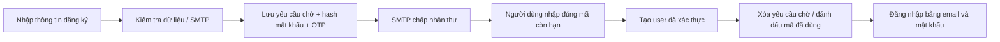

# 08 — Đăng nhập Google và hoàn tất đăng ký

[Mục lục](README.md) · [Cấu hình email](05-CAU-HINH-VA-TICH-HOP.md)

## 1. Những lỗi đã sửa ngày 19/10/2026

| Hiện tượng | Nguyên nhân trong code cũ | Cách xử lý |
|---|---|---|
| Bấm Google trên trang đăng ký không đi đâu | Nút chưa có hành động | Dùng liên kết OAuth thật, cùng luồng với trang đăng nhập |
| Google đã tạo tài khoản nhưng vẫn bị đưa đến OTP | Chưa đặt trạng thái xác thực/loại tài khoản đầy đủ | Google phải trả email đã xác minh; tạo/cập nhật tài khoản hoàn chỉnh rồi về trang phù hợp |
| Đã vào bằng Google nhưng giỏ không nhận tài khoản | Principal dùng tên hiển thị, truy vấn ID lại dùng email | Định danh principal và tìm user theo email chuẩn hóa |
| Có quyền trong DB nhưng chuyển trang bị sai | OAuth luôn gán `ROLE_USER`, handler lại dùng role trong DB | Authority lấy từ role lưu trong DB; không lấy role do profile tự khai báo |
| Đăng ký email chưa nhập OTP đã có trong `users` | Code lưu user với trạng thái chờ trước khi gửi mã | Tách `pending_registration`; chỉ tạo user sau khi xác thực đúng OTP |
| Đăng nhập xong lại đến trang không được phép/404 | Ưu tiên saved request trước kiểm tra kích hoạt/quyền | Kiểm tra trạng thái trước, chỉ dùng lại các đường dẫn an toàn cùng host, còn lại về trang theo role |
| Cảnh báo `th:include` khi render trang 404 | Cú pháp template cũ | Dùng fragment expression hiện hành; trang lỗi hiện đường dẫn không tìm thấy |
| Trang 404 phát sinh lỗi JavaScript | Đoạn voucher mẫu gọi phần tử không tồn tại | Bỏ đoạn mã mẫu không thuộc trang lỗi |
| Chuyển trang nhanh phát sinh lỗi socket | Presence cố gửi STOMP frame khi socket chưa mở/đã đóng | Kiểm tra trạng thái và đóng kết nối/dừng reconnect khi rời trang |

Cảnh báo Thymeleaf trong log người dùng gửi **không tự chứng minh lỗi mật khẩu hay Google**. Nó xuất hiện vì một request đã vào trang 404. Cần xác định URL thực tế; bản mới hiển thị path trên trang lỗi. Đã sửa ảnh logo `.jpg` không tồn tại ở trang OTP và dùng đường dẫn tài nguyên đúng.

## 2. Đăng ký email: khi nào có tài khoản?



- Trước bước nhập đúng mã: **chưa có tài khoản mới trong `users`**, chưa được đăng nhập.
- Có dữ liệu xác thực tạm trong `pending_registration` và `otp_codes`; mật khẩu chỉ lưu hash BCrypt, không lưu mật khẩu thuần.
- Mã và yêu cầu chờ có hạn 10 phút. Có thể gửi lại, kiểm tra khoảng cách 60 giây; lỗi SMTP rollback dữ liệu mới. Nếu SMTP không cấu hình, không giả vờ đã gửi mã.
- Đăng ký trùng một yêu cầu chờ còn hạn không thay mật khẩu của yêu cầu đó; hãy mở bước xác thực/gửi lại mã.
- Xác thực thành công mới tạo tài khoản, sau đó chuyển về đăng nhập; không tự đăng nhập chỉ vì nhập form đăng ký.
- Tài khoản chờ từ bản cũ **không bị xóa hàng loạt**. User thường loại `NORMAL`, còn hoạt động và chưa xác thực vẫn có thể gửi lại/nhập OTP để hoàn tất. Tài khoản bị xóa/khóa không được dùng OTP để tự mở khóa.
- Yêu cầu chờ hết hạn không cấp quyền đăng nhập. Chưa triển khai tác vụ dọn định kỳ tất cả dữ liệu chờ; cần chính sách lưu trữ nếu triển khai thật.

## 3. Đăng ký/đăng nhập Google

Hai nút dùng chung `/oauth2/authorization/google`:

1. Web tạo OAuth authorization request và state.
2. Người dùng đăng nhập/chấp thuận trên Google.
3. Google trả authorization code về `/login/oauth2/code/google`.
4. Spring trao đổi token và lấy profile; service yêu cầu **email có `email_verified=true`**.
5. Email mới: tạo user loại Google, đã xác thực và role khách hàng. Không yêu cầu OTP của cửa hàng nữa vì Google đã chứng minh quyền sở hữu email.
6. Email đã có tài khoản hoạt động: không tạo bản sao; giữ role trong database. Tài khoản email/mật khẩu đã xác thực giữ mật khẩu hiện có.
7. Nếu tài khoản/yêu cầu email cũ chưa được xác thực: khi Google chứng minh cùng email, bỏ mật khẩu và thông tin chờ chưa đáng tin; không để mật khẩu chọn trước lúc xác minh còn dùng được. Tài khoản trở thành loại Google, yêu cầu chờ/OTP cũ bị vô hiệu.
8. Tài khoản bị xóa/vô hiệu/khóa thủ công không được Google tự mở. Khóa tạm do đăng nhập sai chỉ hết theo thời hạn quy định. Tài khoản nội bộ chưa kích hoạt không được SSO tự cấp quyền.

Không tin role do profile khai báo. Facebook không tự liên kết vào tài khoản mật khẩu/Google chỉ vì trùng email; không trình bày việc liên kết đa nhà cung cấp là đã hoàn thiện. Hệ thống hiện ghép Google theo email đã xác minh; triển khai production nên bổ sung định danh provider/subject, quy trình liên kết rõ ràng và kiểm thử đồng thời/phiên đăng nhập.

## 4. Cấu hình Google của chính nhóm

1. Google Cloud Console → chọn/tạo project → cấu hình OAuth consent/Google Auth Platform theo yêu cầu tài khoản.
2. Tạo OAuth Client loại **Web application**. Nếu ứng dụng đang Testing và Google yêu cầu, thêm email thử vào Test users.
3. Khai báo cho local cổng 8080:
   - Authorized JavaScript origin: `http://localhost:8080` (nếu cấu hình client yêu cầu).
   - Authorized redirect URI: **`http://localhost:8080/login/oauth2/code/google`**.
4. Trong IntelliJ → Run → Edit Configurations → Environment variables, đặt **cả hai**:

   ```text
   SPRING_SECURITY_OAUTH2_CLIENT_REGISTRATION_GOOGLE_CLIENT_ID=<Client-ID-Web-application-của-bạn>
   SPRING_SECURITY_OAUTH2_CLIENT_REGISTRATION_GOOGLE_CLIENT_SECRET=<Client-Secret-của-chính-Client-ID-đó>
   ```

5. Dừng/chạy lại đúng cấu hình. Mở `http://localhost:8080/login` hoặc `/register`, bấm Google, hoàn tất consent rồi quay lại web.

Không ghép secret mới với Client ID cũ có sẵn trong source. Không gửi secret vào chat/Git. Nếu thiếu ID/secret, nút Google không được bật; truy cập trực tiếp đường dẫn OAuth cũng hiện thông báo cấu hình thay vì giả lập đăng nhập thành công.

Nếu dùng `127.0.0.1`, cổng khác hoặc HTTPS ngrok, phải khai báo **đúng URL tương ứng** trên Google và bắt đầu phiên bằng cùng host. Không trộn localhost và ngrok giữa chừng. Ví dụ ngrok: `https://<domain-hiện-tại>/login/oauth2/code/google`. OAuth redirect này khác return URL VNPay `/check-vnpay`.

`redirect_uri_mismatch` cần đối chiếu scheme/host/port/path chính xác. `invalid_client` cần kiểm tra cặp Client ID/Secret và loại ứng dụng. Khi hủy consent, email chưa xác minh, state không hợp lệ hoặc Google lỗi, web trở về trang đăng nhập với thông báo; không tạo tài khoản bằng một callback không hợp lệ.

## 5. Cập nhật project/database

- Pull/tải toàn bộ code mới, không chỉ chép SQL. Stop/Run lại app và Ctrl+F5.
- Bộ [SQL cài mới](../sql/install/README.md) đã có `pending_registration`. Với database đang dùng, backup và xem [maintenance](../sql/README.md); không import lại installer để chỉ sửa OAuth/OTP. Không dùng ddl-auto thay cho kế hoạch nâng schema.
- Script chỉ tạo bảng còn thiếu, không DROP database, không xóa/bật tài khoản, không thay mật khẩu hay đơn hàng. Sao lưu DB trước cập nhật.
- Bản SQL đầy đủ và bổ sung đã gồm schema mới. Không import lại dump đầy đủ chỉ để sửa đăng nhập, vì dump đầy đủ có DROP DATABASE.
- Không sửa `activation_status=1` cho mọi người hoặc xóa tài khoản chờ để né xác thực. Dùng luồng OTP/Google hợp lệ.

## 6. Kiểm chứng và giới hạn

Kiểm thử gồm service Google với profile được xác minh/không xác minh, role, khóa, mật khẩu chờ, principal email; handler redirect/state; đăng ký/OTP và dữ liệu chờ. Có kiểm tra trình duyệt qua một **nhà cung cấp OAuth giả lập cục bộ** thực hiện authorization → code → token → userinfo → callback; xác minh tài khoản và giỏ hàng đúng user, lỗi consent/state không tạo user. SMTP cũng là sink cục bộ, không gửi thư thật.

Không đưa endpoint/Client Secret giả lập vào cấu hình production hoặc Git. Chưa xác minh bằng Google Client thật của người dùng, chưa chứng minh tài khoản Google Cloud đã cấp quyền đúng hoặc Gmail nhận thư thật. Khi cấu hình thực, cần kiểm thử lại cùng tài khoản Google của nhóm. Các thay đổi không tự xóa dữ liệu cũ hoặc tự sửa cấu hình Google Cloud bên ngoài.
